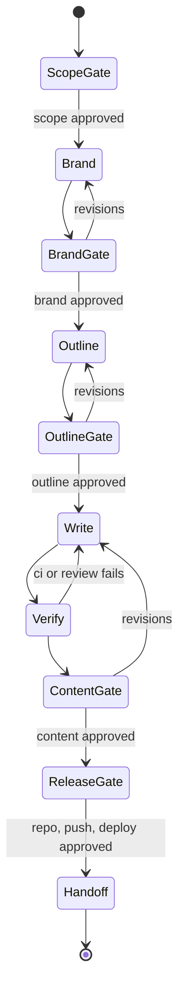

# /docs-site

Create a branded documentation site for any application from the
[quire](https://github.com/smeltery/quire) template. The skill reads the
application's code and UI, maps its colors, logo, and voice into `brand.json`,
proposes a page outline traced to real sources, writes the pages, verifies
them in a browser, and publishes only after you approve.

## Lifecycle



Each gate waits for your decision. State lives in `.docs-site/state.json`
inside the docs checkout, so a later run resumes at the earliest unfinished
phase.

## Usage

```text
/docs-site smeltery/convrt
/docs-site https://github.com/acme/widgets --docs-repo acme/widgets-docs
/docs-site ./my-app --target ../my-app-docs
```

## Requirements

- `gh` authenticated for the template and the destination organization.
- Bun 1.3+, or Flox (`flox activate` installs everything).
- A browser tool for brand sampling and page review.

## Resources

- [Brand extraction](references/brand-extraction.md)
- [Content guide](references/content.md)
- [quire documentation](https://github.com/smeltery/quire/tree/main/docs)
