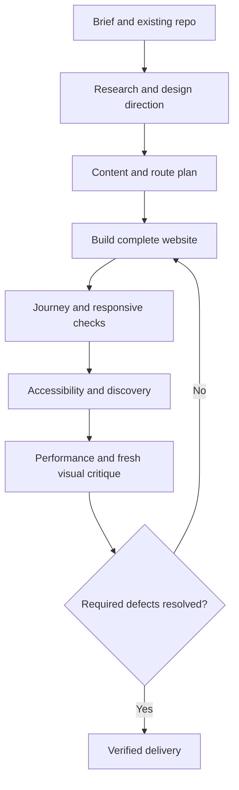

# Website Studio

Take a brief, an empty directory, or an existing repository to a complete,
polished website. The agent chooses a direction, builds all pages and journeys,
inspects the result in a browser, and repairs UX problems without repeated
design prompts.

```text
/website-studio Build a website for a fictional coastal architecture studio
/website-studio Improve this repo using https://example.com as a reference
/website-studio Create a consulting website --target ./consulting-site
```

Twelve gates cover context, references, direction, structure, build, journeys,
responsive behavior, accessibility, discovery, performance, critique, and
delivery. They require evidence, not user approval at every phase.



The bundled Python controller enforces gate order, required receipts, existing
evidence, and invalidation when inputs change. It does not replace visual
judgment or prove that tests were run. Evidence stays local in
`.website-studio/`, and the workflow resumes from the earliest incomplete gate.

Local production preview is the default. Commit, push, and deployment follow
the user's authorization. Missing credentials or essential business facts are
reported honestly; forms never claim success without delivery confirmation.

Use [ui-studio](../ui-studio/README.md) for a reusable UI kit and showcase.
Use this skill for a finished website with real content and user journeys.

## Install

```bash
npx skills add smeltery/skills --skill website-studio
```

Install the entire skill directory, including its references and scripts.
Python 3.10+ enables the gate controller; browser automation enables actual
rendered verification. The website itself uses the project's appropriate stack.

## Guides

- [Skill instructions](SKILL.md)
- [Gate protocol](references/gate-protocol.md)
- [Design and content](references/design.md)
- [Implementation and UX checks](references/ux-checks.md)
- [Verification and delivery](references/verification.md)
- [Reference sites and repository findings](references/reference-study.md)
- [Evaluation scenarios](references/evaluation.md)

Run the controller's regression tests:

```bash
python3 -m unittest discover -s skills/engineering/website-studio/tests -v
```
